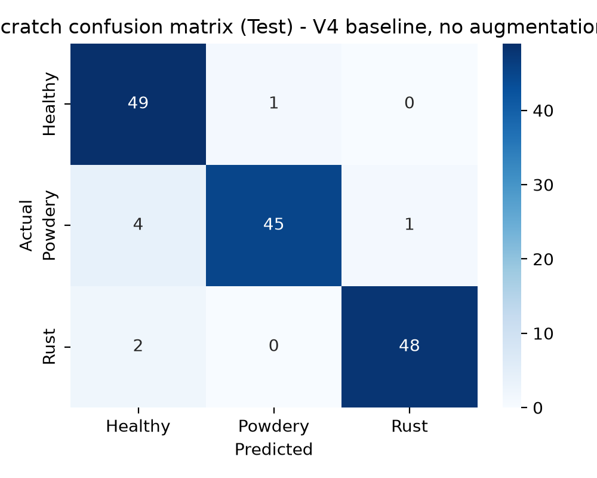
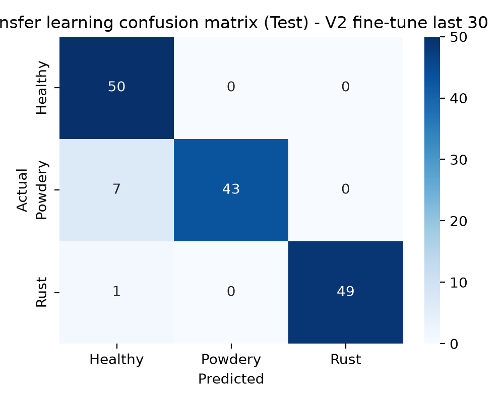
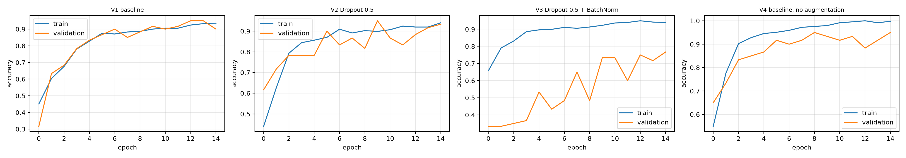
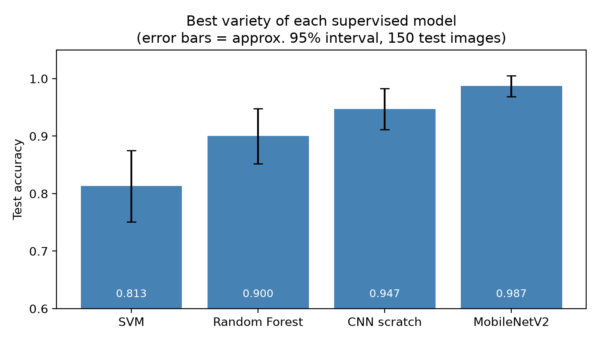

# 🌿 Plant Disease Recognition from Leaf Images
### Classical Machine Learning vs Deep Learning (IT2011 – AI & ML, SLIIT)

Can a computer tell a healthy leaf from one with **powdery mildew** or **rust**? This project compares **six approaches**, from classical machine learning on hand-made features to CNNs and transfer learning, on the same dataset and evaluates them in the same way.

**Best result: 94.7% test accuracy** (CNN from scratch and fine-tuned MobileNetV2) on 150 unseen images.

---

## 📌 Overview

| | |
|---|---|
| **Task** | 3-class image classification: `Healthy`, `Powdery`, `Rust` |
| **Dataset** | [Plant Disease Recognition Dataset](https://www.kaggle.com/datasets/rashikrahmanpritom/plant-disease-recognition-dataset) (Kaggle) |
| **Split** | Train 1,322 · Validation 60 · Test 150 |
| **Approach** | 6 models, several tuned "varieties" each, one shared results table |
| **Tools** | Python, scikit-learn, TensorFlow/Keras, OpenCV, NumPy, Pandas, Matplotlib, Seaborn |

---

## 🧠 Models and why they were chosen

| # | Model | Input features | Why this model |
|---|---|---|---|
| 1 | **PCA** (+ SVM check) | 64×64 pixels, flattened | Reduce 12,288 pixel values to fewer components and test whether that helps classification |
| 2 | **SVM** | RGB colour histogram (8×8×8) | Works well on small, high-dimensional data. The RBF kernel can model non-linear class boundaries |
| 3 | **Random Forest** | RGB colour histogram | Robust on small datasets, little tuning needed, gives feature importance |
| 4 | **K-Means** | Pixels + PCA, histogram | Unsupervised baseline: do the leaves cluster into the disease classes on their own? |
| 5 | **CNN (from scratch)** | 128×128 images | Learns visual features directly instead of hand-made ones |
| 6 | **MobileNetV2** (transfer learning) | 224×224 images | Reuses ImageNet knowledge, which suits a small dataset |

Every notebook follows the same structure: model suitability → implementation → tuning method → evaluation metric and validation method → comparison of varieties → conclusion and limitations.

---

## 📊 Results

Best variety per model (full table: `results/outputs/model_results.csv`):

| Model | Best variety | Validation acc. | **Test acc.** |
|---|---|---|---|
| MobileNetV2 | Fine-tune last 30 layers | 0.983 | **0.947** |
| CNN (scratch) | Baseline, no augmentation | 0.950 | **0.947** |
| Random Forest | 50 trees, colour histogram | 0.933 | **0.900** |
| SVM | RBF kernel, C=10 | 0.800 | **0.833** |
| PCA + SVM | 150 components | 0.800 | **0.707** |
| K-Means | Pixels + PCA, k=3 | n/a (unsupervised) | ARI 0.099 |

### Confusion matrices

| CNN (scratch) | MobileNetV2 | Random Forest |
|---|---|---|
|  |  |  |

### Training curves and model comparison




---

## 🔍 Key findings

1. **Deep learning performed best.** Both CNN models reached 94.7% test accuracy, compared with 90.0% for the best classical model (Random Forest) and 83.3% for SVM.
2. **Simple colour features go a long way.** A 512-value colour histogram gave Random Forest 90% accuracy. This makes sense because rust (orange-brown) and powdery mildew (white) differ mainly in colour.
3. **PCA did not help the SVM.** Without PCA the SVM scored 0.747 test accuracy, while 150 PCA components scored 0.707. Compressing the pixels discarded information that mattered.
4. **K-Means could not recover the disease classes.** The best ARI was only 0.21 on the training set and about 0.10 on the test set. Raw pixel similarity does not match disease type.
5. **More regularisation was not always better.** Adding Dropout + BatchNorm to the scratch CNN dropped test accuracy to 0.80, and the version without augmentation scored best. On a small dataset, the architecture and training setup need to be tuned together.
6. **The scratch CNN overfits.** Training accuracy was 99.8% against 94.7% on test.
7. **Fine-tuning MobileNetV2 gave only a small gain** over keeping the base frozen (0.94 → 0.947). With 150 test images, one image equals 0.67%, so this difference is within noise.

---

## ⚠️ Limitations

- **Small evaluation sets.** The validation set has 60 images (one image ≈ 1.7%) and the test set 150, so differences of a few points are not statistically reliable.
- **Controlled data.** The dataset images are clean leaf photos. Real field photos (lighting, background, several leaves) would probably lower accuracy.
- **Only 3 classes.** The models cannot recognise other diseases or leaves from other plant species.
- **No uncertainty estimates.** Results come from a single train/test split, apart from 5-fold CV on the classical models.

## 🚀 Future work

- Use cross-validation or repeated runs for all models, and report confidence intervals.
- Test on real field images and add stronger augmentation.
- Try other pretrained backbones (EfficientNet, ResNet) and compare model size and speed.
- Add Grad-CAM to show which parts of the leaf the CNN looks at.
- Deploy the best model as a small web or mobile app for farmers.

---

## 💡 Skills demonstrated

Image preprocessing (resizing, normalisation, colour histograms) · feature engineering · dimensionality reduction (PCA) · supervised and unsupervised learning · hyperparameter tuning (grid search, cross-validation) · CNN design · transfer learning and fine-tuning · overfitting analysis · evaluation (accuracy, confusion matrix, ARI/NMI) · reproducible experiments (fixed seed 42) · group collaboration.

---

## 📁 Project structure

```
├── README.md
├── requirements.txt
├── .gitignore
├── data/raw/                  <- put the dataset here
├── notebooks/
│   ├── PCA_Model.ipynb
│   ├── SVM_Model.ipynb
│   ├── RandomForest_Model.ipynb
│   ├── KMeans_Model.ipynb
│   ├── CNN_Scratch.ipynb
│   ├── CNN_Transfer.ipynb     <- MobileNetV2, built for Google Colab
│   └── Model_Comparison.ipynb
└── results/
    ├── eda_visualizations/    <- charts and confusion matrices
    ├── outputs/               <- model_results.csv, feature cache, saved .keras models
    └── logs/                  <- corrupted-image check logs
```

---

## 📥 Add the dataset

The images are **not included** in this repository. Add them before running any notebook.

1. Download from [Kaggle](https://www.kaggle.com/datasets/rashikrahmanpritom/plant-disease-recognition-dataset) and unzip.
2. Place the folders exactly like this (the dataset itself is nested):

```
data/raw/
├── Train/Train/{Healthy,Powdery,Rust}/
├── Validation/Validation/{Healthy,Powdery,Rust}/
└── Test/Test/{Healthy,Powdery,Rust}/
```

3. Open notebooks from inside the `notebooks/` folder. Each one uses `DATA_ROOT = '../data/raw'`. Change this only if you put the data elsewhere.
4. Quick check (run inside `notebooks/`):

```python
import os
for split in ['Train', 'Validation', 'Test']:
    for cls in ['Healthy', 'Powdery', 'Rust']:
        p = f'../data/raw/{split}/{split}/{cls}'
        print(p, len(os.listdir(p)) if os.path.exists(p) else 'MISSING')
```

**Your own images:** keep the same folder layout, update `CLASS_NAMES` if your classes differ, and delete `results/outputs/plant_features.npz` so features are rebuilt.

### `CNN_Transfer.ipynb` (Google Colab)
This notebook expects a **non-nested** layout:
1. Zip a folder `raw/` containing `Train/`, `Validation/`, `Test/` (each with `Healthy`, `Powdery`, `Rust`) as `raw.zip`.
2. Upload it to `MyDrive/raw.zip`.
3. Open the notebook in Colab, choose **Runtime → Change runtime type → GPU**, and run all cells.

To run locally, remove the Colab cells (`google.colab`, `drive.mount`, `!unzip`) and set:
```python
TRAIN_DIR = '../data/raw/Train/Train/'
VAL_DIR   = '../data/raw/Validation/Validation/'
TEST_DIR  = '../data/raw/Test/Test/'
```

---

## ▶️ How to run

```bash
git clone https://github.com/thenujaya-mihisara/plant-disease-recognition.git
cd plant-disease-recognition
python -m venv venv
venv\Scripts\activate          # Windows  (macOS/Linux: source venv/bin/activate)
pip install -r requirements.txt
jupyter notebook
```

Suggested order: `PCA_Model` (builds the feature cache) → `SVM_Model` → `RandomForest_Model` → `KMeans_Model` → `CNN_Scratch` → `CNN_Transfer` → `Model_Comparison`.

Notes:
- Feature cache: `results/outputs/plant_features.npz` (delete to rebuild).
- TensorFlow models train slowly on CPU (about 1–2 min per epoch). On native Windows, TensorFlow 2.11+ does not use the GPU, so use WSL2 or Colab.
- Seeds are fixed (42), but results can vary slightly between machines and library versions.

### Load a saved model
```python
import tensorflow as tf
model = tf.keras.models.load_model('results/outputs/cnn_scratch.keras')
```

